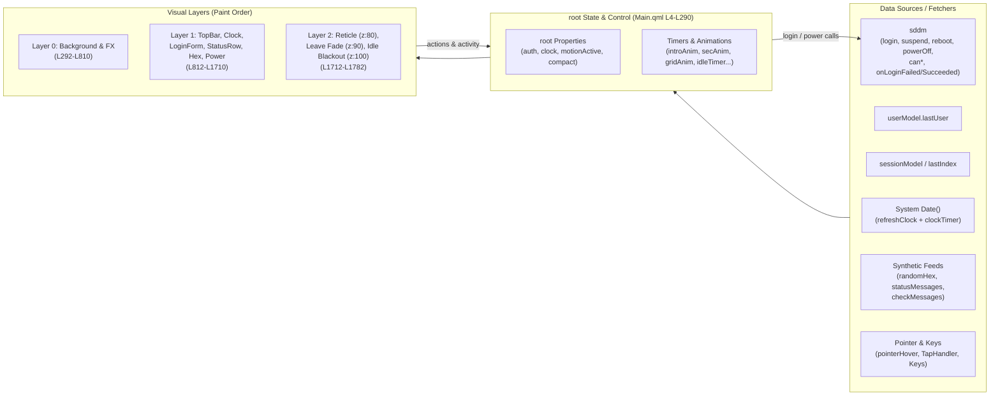

# Aurora Terminal — Master Map

A complete structural map of **Aurora Terminal** (`Main.qml`, `metadata.desktop`, `README.md`, `assets/`) designed to make **adding, editing, or removing features and data fetchers** fast and safe without leaving orphaned state, timers, or broken bindings.

> **Line references** point to [`Main.qml`](./Main.qml) (1,792 lines).

---

## 1. Repository Layout

| File | Lines | Purpose | Runtime Needed by SDDM? |
| :--- | :---: | :--- | :---: |
| [`Main.qml`](./Main.qml) | 1,792 | Entire SDDM theme UI, state, helpers, timers, animations, SDDM hooks | Yes (`MainScript`) |
| [`metadata.desktop`](./metadata.desktop) | 13 | SDDM Theme API 2.0 / Qt 6 descriptor (`Theme-Id=aurora-glass-sddm`) | Yes |
| [`README.md`](./README.md) | 87 | User docs, preview/install/uninstall commands | No |
| [`assets/aurora-terminal-preview.png`](./assets/aurora-terminal-preview.png) | — | Preview screenshot referenced by `metadata.desktop` & `README.md` | Optional |
| [`assets/aurora-terminal-login.png`](./assets/aurora-terminal-login.png) | — | Additional login screen screenshot | No |

---

## 2. High-Level Architecture & Data Flow

All logic, data bindings, timers, and UI layers live in a single root `Item` (`id: root`) in [`Main.qml`](./Main.qml).



### The 4-Zone Pattern Inside `Main.qml`

Every feature or data fetcher in `Main.qml` typically touches up to **4 zones**:

1. **State Properties** (`L9–L45`) — properties on `root`
2. **Helper Functions** (`L48–L166`) — logic called by timers, handlers, or UI
3. **Timers / Animations / Handlers / `Connections`** (`L168–L290`) — ticks, lifecycle triggers, SDDM signals
4. **Visual Block** (`L292–L1782`) — QML `Item` / `Repeater` / `Text` / `Button`

*(Exception: `vScan` and `hScan` keep their own `Timer`, `NumberAnimation`, and `Connections` encapsulated inside their visual `Item`s.)*

---

## 3. Master Index of `Main.qml`

### A. Root State Properties (`L4–L46`)

| Group | Property | Type | Line | Controlled By | Consumed By |
| :--- | :--- | :--- | :---: | :--- | :--- |
| **Auth** | `message` | `string` | L9 | `submitLogin()`, `sddm` `Connections` | `feedback` (`L1353`) |
| | `authFailed` | `bool` | L16 | `sddm.onLoginFailed`, `submitLogin()`, `passwordField` | `formFrame`, `passwordField` underline |
| | `leaving` | `bool` | L17 | `sddm.onLoginSucceeded` | `signInButton`, leave fade (`L1746`) |
| | `authenticating` | `bool` | L18 | `submitLogin()`, `sddm` `Connections` | `formFrame`, `signInButton`, `statusRow`, auth timers |
| | `denied` | `bool` | L29 | `sddm.onLoginFailed`, `deniedTimer` | `signInButton` |
| | `checkStep` | `int` | L30 | `submitLogin()`, 650ms `Timer` (`L210`) | `signInButton` label (`checkMessages`) |
| | `spinStep` | `int` | L31 | `submitLogin()`, 90ms `Timer` (`L217`) | `signInButton` spinner (`\|/-\`) |
| | `checkMessages` | `var` (`readonly`) | L32 | Static array (4 messages) | `signInButton` (`L1416`) |
| **Clock** | `hourText`, `minuteText`, `periodText`, `dateText` | `string` | L10–L13 | `refreshClock()` (`L66`) | `clockPanel` (`L913`, `L929`, `L956`, `L971`) |
| | `secFrac` | `real` | L26 | `refreshClock()`, `secAnim` (`L178`) | Seconds progress bar (`L1020–L1021`) |
| **Motion & Idle** | `screenActive` | `bool` | L14 | `enterIdleMode()`, `wakeFromIdle()` | `motionActive`, `clockTimer`, `idleTimer`, blackout (`L1755`) |
| | `animationsEnabled` | `bool` | L15 | `animationButton` (`L1553`) | `motionActive`, `refreshClock()`, `onAnimationsEnabledChanged`, FX visibility |
| | `motionActive` | `bool` (`readonly`) | L44 | `screenActive && animationsEnabled` | Master gate for all looping animations & ambient timers |
| | `intro` | `real` | L19 | `introAnim` (`L168`), `onAnimationsEnabledChanged` | `stage(start, span)` (`L48`) |
| | `idleFocusTarget` | `string` | L43 | `rememberIdleFocusTarget()`, `wakeFromIdle()` | Focus restoration after wake (`L129–L138`) |
| **Pointer** | `pointerX`, `pointerY` | `real` | L20–L21 | `pointerHover` (`L246`) | `smoothX`, `smoothY` |
| | `smoothX`, `smoothY` | `real` + `Behavior` | L22–L23, L41–L42 | Follow `pointerX`/`pointerY` (450ms `OutCubic`) | `backgroundPanel`, `auroraWash`, `reticle` |
| | `pointerDown` | `bool` | L24 | `TapHandler` (`L255`) | `reticle` scale (`L1720`) |
| **Ambient** | `gridPhase` | `real` | L25 | `gridAnim` (`L185`) | Grid vertical & horizontal `Repeater`s (`L416`, `L431`) |
| | `gridCols`, `gridRows` | `int` (`readonly`) | L39–L40 | `Math.ceil(width/height / 64) + 1` | Grid `Repeater`s (`L412`, `L427`) |
| | `hexLine` | `string` | L27 | `randomHex()`, 140ms `Timer` (`L196`) | Hex ticker `Text` (`L1581`) |
| | `statusTick`, `statusMessages`, `statusLine` | `int`, `var`, `string` | L28, L33–L38 | 450ms `Timer` (`L203`) | `clockSub` (`L988`) |
| **Responsive** | `compact` | `bool` (`readonly`) | L45 | `width < 900 \|\| height < 680` | Hides rings/radar/rulers/frame/clockSub/secBar; stacks layout |

---

### B. Helper Functions (`L48–L166` & `L1784–L1791`)

| Function | Lines | Responsibility |
| :--- | :---: | :--- |
| `stage(start, span)` | L48–L52 | Maps `root.intro` slice into cubic-eased `0..1` entrance progress |
| `typeText(str, start, span)` | L55–L57 | Typewriter reveal driven by `stage(start, span)` |
| `randomHex()` | L59–L64 | Generates 8 space-separated uppercase hex bytes (`"XX XX ..."` ) |
| `refreshClock()` | L66–L86 | Sets 12h clock & date strings, schedules `clockTimer` for next minute boundary, syncs `secAnim` |
| `submitLogin()` | L88–L105 | Validates `usernameField`, clears errors, sets `authenticating = true`, calls `sddm.login(...)` |
| `focusInitialInput()` | L107–L113 | Focuses `passwordField` if username prefilled, else `usernameField` |
| `noteActivity()` | L115–L118 | Restarts 30s `idleTimer` when `screenActive` |
| `wakeFromIdle()` | L120–L139 | Sets `screenActive = true`, refreshes clock, restarts `idleTimer`, restores `idleFocusTarget` |
| `enterIdleMode()` | L141–L146 | Saves focus via `rememberIdleFocusTarget()`, sets `screenActive = false` |
| `rememberIdleFocusTarget()` | L148–L158 | Captures `"password"`, `"username"`, `"session"`, or `""` |
| `onAnimationsEnabledChanged` | L160–L166 | Snaps `intro = 1` if paused mid-intro; refreshes clock |
| `Component.onCompleted` | L1784–L1791 | Calls `refreshClock()`, `focusInitialInput()`, starts `introAnim` (or sets `intro = 1`) |

---

### C. Timers, Root Animations, Input Handlers & SDDM Signals (`L168–L290`)

| Item / Handler | Lines | Interval / Duration | Condition (`running`) | Action |
| :--- | :---: | :---: | :--- | :--- |
| `introAnim` | L168–L176 | 1300ms | Started in `onCompleted` | Drives `root.intro` `0 -> 1` |
| `secAnim` | L178–L183 | Dynamic (`<= 60s`) | Started in `refreshClock()` | Drives `root.secFrac -> 1` |
| `gridAnim` | L185–L194 | 9000ms loop | `root.motionActive` | Drives `root.gridPhase` `0 -> 1` |
| Hex `Timer` | L196–L201 | 140ms loop | `root.motionActive && root.width > 1200` | `root.hexLine = root.randomHex()` |
| Status `Timer` | L203–L208 | 450ms loop | `root.motionActive` | `root.statusTick++` |
| Auth check `Timer` | L210–L215 | 650ms loop | `root.authenticating` | `root.checkStep++` |
| Auth spin `Timer` | L217–L222 | 90ms loop | `root.authenticating` | `root.spinStep++` |
| `deniedTimer` | L224–L229 | 2200ms once | Restarted on `onLoginFailed` | `root.denied = false` |
| `clockTimer` | L231–L237 | Minute-aligned | `root.screenActive` | `root.refreshClock()` |
| `idleTimer` | L239–L244 | 30000ms once | `true` (restarted on activity) | `root.enterIdleMode()` |
| `pointerHover` (`HoverHandler`) | L246–L253 | — | Always active | `noteActivity()`, updates `pointerX`/`pointerY` |
| `TapHandler` | L255–L261 | — | Always active | Updates `pointerDown`, calls `noteActivity()` |
| Initial focus `Timer` | L263–L268 | 200ms once | `true` | `root.focusInitialInput()` |
| `Connections { target: sddm }` | L270–L290 | Signal-driven | `onLoginFailed` / `onLoginSucceeded` | Updates auth flags, `message`, `shakeAnim`, `leaving` |

---

### D. Visual Layers & UI Modules (`L292–L1782`)

#### Layer 0 — Background, Grid & Ambient Effects (`L292–L810`)

| Module / ID | Lines | Visibility / Responsive Gate | Notes |
| :--- | :---: | :--- | :--- |
| Backdrop `Rectangle` | L292–L295 | Always | Solid `#090d0e` base |
| `backgroundPanel` | L297–L350 | Always | `-18°` panel; pointer parallax + 18s `x/y` drift |
| `auroraWash` | L352–L408 | Intro `stage(0, 0.9)` | `-18°` teal glow; stronger parallax + 48s `x` drift + 18s `glowOpacity` |
| Background Grid (`Repeater` × 2) | L410–L439 | Intro `stage(0, 0.9)` | 64px vertical & horizontal lines with traveling wave (`gridPhase`) |
| Rising Motes (`Repeater`) | L441–L463 | `animationsEnabled ? 16 : 0` | 16 drifting dots (`#b6fa73` / `#7cc7ff`) |
| Expanding Rings (`Repeater`) | L465–L494 | `!compact && animationsEnabled` | 2 pulsing circles; **hardcoded** to non-compact `clockPanel` center |
| `radar` | L496–L569 | `!compact && animationsEnabled` | 600×600 dial behind clock (`120s` ticks + `9s` sweep); **hardcoded** position |
| `vScan` (`vScanTimer`, `vScanAnim`) | L571–L631 | `animationsEnabled && active` | Self-contained top-to-bottom 90px scan band on random intervals |
| `hScan` (`hScanTimer`, `hScanAnim`) | L633–L694 | `animationsEnabled && active` | Self-contained left-to-right 90px scan band on random intervals |
| `statusMetrics` (`TextMetrics`) | L696–L702 | Non-visual | Measures `"AWAITING CREDENTIALS"` width for `statusRow` (`L1539`) |
| Edge `ruler`s (`Repeater` × 2) | L704–L744 | `!compact` | Left/right drifting tick strips (`x: 20` and `width - 30`) |
| `formFrame` | L746–L793 | `!compact` | Corner brackets + perimeter light around `loginForm`; reacts to `authFailed` & `authenticating` |
| Structural Dividers (`Rectangle` × 2) | L795–L810 | `root.width > 900` | Vertical rule (`x: 0.58*width`) & horizontal rule (`y: 0.22*height`) |

#### Layer 1 — Primary UI & Controls (`L812–L1710`)

| Module / ID | Lines | Anchor / Position | Key Sub-elements & Bindings |
| :--- | :---: | :--- | :--- |
| `topBar` | L812–L892 | Top edge | `"A / S"`, typewriter `"LOCAL SESSION  /  AUTH GATE"`, `systemReadyDot` + `readyRing` + `"SYSTEM READY"` |
| `clockPanel` | L894–L1023 | Left-center (top-center if `compact`) | `clockDate`, `clockRow` (hour, pulsing `clockColon`, sliding `minuteDigits`, AM/PM), `clockSub` (`statusLine`, `!compact`), seconds bar (`secFrac`, `!compact`) |
| `loginForm` | L1025–L1508 | Right-center (stacked if `compact`) | `shakeAnim`, `"01 / AUTHENTICATE"`, `login();` + `titleCaret`, `usernameField` (`userModel.lastUser`), `passwordField`, `sessionBox` (`sessionModel`), `feedback` (`root.message`), `signInButton` (`fillAnim`/`fillFinish`, `checkMessages`, spinner), enter hint |
| `statusRow` | L1510–L1573 | Bottom-left | `statusCaret` (`caretBlink`), `"VERIFYING..."` / `"AWAITING CREDENTIALS"`, `animationButton` (`STOP/START ANIMATION`) |
| Hex Data Ticker (`Text`) | L1575–L1587 | Bottom-center (`width > 1200`) | `"RX  " + root.hexLine` |
| `powerRow` | L1589–L1710 | Bottom-right | `"POWER"` label + `sleepButton` (`sddm.canSuspend/suspend()`), `restartButton` (`sddm.canReboot/reboot()`), `powerOffButton` (`sddm.canPowerOff/powerOff()`) |

#### Layer 2 — Overlays (`L1712–L1782`)

| Module / ID | Lines | `z` | Trigger / Visibility | Behavior |
| :--- | :---: | :---: | :--- | :--- |
| `reticle` | L1713–L1739 | `80` | `animationsEnabled` + `pointerHover.hovered && motionActive` | Rotating crosshair at `(smoothX, smoothY)`; scales to `0.6` on `pointerDown` |
| Leave Fade `Rectangle` | L1742–L1749 | `90` | `opacity > 0` (`root.leaving`) | Fades screen to `#000000` (380ms) on `sddm.onLoginSucceeded` |
| Idle Blackout `Item` (`blackout`) | L1752–L1782 | `100` | `!screenActive \|\| blackout.opacity > 0` | Fades to `#000000` after 30s (`1200ms` in, `220ms` out); `MouseArea` + `Keys.onPressed` call `wakeFromIdle()` |

---

## 4. Data Fetchers & External SDDM Bindings

Because Aurora Terminal runs inside `sddm-greeter-qt6` with no network access (`README.md`), all active "fetchers" are either **SDDM-injected context objects**, **Qt date/time**, or **local synthetic generators**:

| Fetcher / Source | Provided Symbols Used | Where Consumed | Notes |
| :--- | :--- | :--- | :--- |
| **`sddm`** (Greeter API 2.0) | `login()`, `suspend()`, `reboot()`, `powerOff()`, `canSuspend`, `canReboot`, `canPowerOff`, `onLoginFailed`, `onLoginSucceeded` | `submitLogin()` (`L104`), `Connections` (`L270–L290`), `powerRow` (`L1616–L1685`) | Test mode (`--test-mode`) stubs auth/power actions |
| **`userModel`** | `userModel.lastUser` | `usernameField.text` (`L1132`) | Prefills last logged-in user; drives `focusInitialInput()` |
| **`sessionModel`** | Model items (`name` role), `lastIndex` | `sessionBox` (`L1260–L1262`, `L1330`) | Populates desktop environment selector |
| **System Clock** | `new Date()`, `Qt.formatDate`, `Qt.formatTime` | `dateText` (`L13`), `refreshClock()` (`L66–L86`), `clockTimer` (`L231–L237`) | Sleeps until next minute boundary; `secAnim` animates seconds bar smoothly |
| **Hex Feed (Synthetic)** | `randomHex()`, `hexLine` | `L27`, `L59–L64`, `L196–L201`, `L1576–L1587` | Purely visual random bytes at 140ms when `width > 1200` |
| **Boot/Auth Status Feeds (Synthetic)** | `statusMessages`/`statusLine`, `checkMessages` | `L28–L38`, `L203–L222`, `L988`, `L1416` | Purely visual status strings |

---

## 5. Design Tokens & Breakpoints

Keep new features and fetchers consistent with the existing theme tokens:

### Color Tokens
- **Backgrounds**: `#090d0e` (base), `#14252b` / `#0e191e` (`backgroundPanel`), `#1d4641` / `#102a2b` (`auroraWash`), `#111a1b` (dropdown popup), `#000000` (overlays)
- **Accent Green**: `#b6fa73` (primary accent, focus lines, caret, clock colon, enter button), `#bff58f` (sleep button), `#2f6b5c` / `#3d5a4d` / `#4f8f6f` / `#2a5a52` (muted structural/FX greens)
- **Accent Cyan / Info**: `#7cc7ff` (restart button, 1/4 of rising motes)
- **Error / Power Off**: `#ff8a80` (power off, denied button), `#ff9f89` (feedback message, failed password underline, `formFrame` error tone)
- **Text Hierarchy**: `#e5ece8` (primary: clock digits, inputs), `#c5d0ca` (session text), `#91a49e` (date, field labels), `#758680` (subtitles, hints)

### Typography & Responsive Gates
- **Font**: `"monospace"` everywhere
- **Compact Gate**: `root.compact` = `width < 900 || height < 680` (`L45`)
- **Wide / Split Thresholds**:
  - `root.width > 900`: divider lines (`L800`, `L809`) + two-column `loginForm` placement (`L1032–L1040`)
  - `root.width > 1200`: Hex Data Ticker timer (`L198`) and text (`L1577`)

---

## 6. Feature & Fetcher Removal Map (Clean Teardown)

Use this table to remove a feature completely without leaving dead timers, properties, or `ReferenceError`s:

| Feature / Fetcher to Remove | Visual Block | State / Helper / Timer Dependencies to Remove Together |
| :--- | :--- | :--- |
| **Hex Data Ticker** | `L1575–L1587` | `hexLine` (`L27`), `randomHex()` (`L59–L64`), 140ms `Timer` (`L196–L201`) |
| **Status Ticker (`clockSub`)** | `L982–L994` | `statusTick` (`L28`), `statusMessages` (`L33`), `statusLine` (`L35–L38`), 450ms `Timer` (`L203–L208`) *(keep `typeText` if `topBar` & `statusRow` still use it)* |
| **Seconds Progress Bar** | `L996–L1022` | `secFrac` (`L26`), `secAnim` (`L178–L183`), and the `secAnim` block inside `refreshClock()` (`L76–L85`) |
| **Radar Dial** | `L496–L569` | Self-contained — safe to delete block directly |
| **Expanding Clock Rings** | `L465–L494` | Self-contained — safe to delete block directly |
| **Rising Motes** | `L441–L463` | Self-contained — safe to delete block directly |
| **Vertical / Horizontal Scanners** | `L571–L631` (`vScan`), `L633–L694` (`hScan`) | Self-contained (each owns its `Timer`, `NumberAnimation`, and `Connections`) |
| **Background Grid** | `L410–L439` | `gridPhase` (`L25`), `gridCols` (`L39`), `gridRows` (`L40`), `gridAnim` (`L185–L194`) |
| **Edge Rulers** | `L704–L744` | Self-contained — safe to delete block directly |
| **Form Frame (Brackets + Lap Light)** | `L746–L793` | Self-contained — reads `loginForm` geometry, `root.authFailed`, `root.authenticating`, `root.motionActive` |
| **Cursor Reticle** | `L1712–L1739` | Only remove `pointerX`/`pointerY`/`smoothX`/`smoothY` (`L20–L23`, `L41–L42`) if **also** removing `backgroundPanel` & `auroraWash` parallax; keep `pointerHover`/`TapHandler` if `idleTimer` needs pointer wake/activity |
| **Auth Spinner / Step Messages** | Inside `signInButton` (`L1414–L1490`) | `checkStep` (`L30`), `spinStep` (`L31`), `checkMessages` (`L32`), auth timers (`L210–L222`), `deniedTimer` (`L224–L229`) |
| **Animation Toggle Button** | `L1547–L1572` | Only if you want motion always on: check `animationsEnabled` (`L15`), `onAnimationsEnabledChanged` (`L160–L166`), and `motionActive` (`L44`) |
| **Bottom-Left Status Row** | `L1510–L1573` | `statusMetrics` (`L696–L702`) — note `animationButton` lives inside `statusRow`! |
| **Power Buttons** | `L1589–L1710` | Self-contained (`sleepButton`, `restartButton`, `powerOffButton`) |
| **Idle Blackout** | `L1751–L1782` | `screenActive` (`L14`), `idleFocusTarget` (`L43`), `noteActivity()` (`L115`), `wakeFromIdle()` (`L120`), `enterIdleMode()` (`L141`), `rememberIdleFocusTarget()` (`L148`), `idleTimer` (`L239`), plus `noteActivity()` calls in `pointerHover`, `TapHandler`, `usernameField`, `passwordField`, `sessionBox` |

> [!WARNING]
> **Watch out for hidden couplings:**
> - `formFrame` (`L746`) reads `loginForm`'s position and size; deleting/renaming `loginForm` breaks `formFrame`.
> - `radar` (`L502–L503`) and `ring` (`L475–L476`) duplicate `clockPanel`'s horizontal/vertical coordinates mathematically rather than anchoring to `clockPanel`. Moving `clockPanel` requires updating those two formulas too.
> - `statusMetrics` (`L696–L702`) is placed far above `statusRow` (`L1539`) even though nothing else uses it.

---

## 7. Playbook: Adding a New Feature or Fetcher

### A. Adding a New Visual / Ambient Feature
1. **Pick the layer** in [`Main.qml`](./Main.qml):
   - Background ambient FX -> between `L292` and `L810`
   - Foreground HUD / control -> between `L812` and `L1710`
   - Full-screen overlay -> `z` between `80` and `95` (keep idle blackout on top at `z: 100`)
2. **Gate motion cleanly**:
   - Loop animations on `running: root.motionActive` (respects both `animationsEnabled` and `screenActive` idle mode)
   - Transitions/Behaviors on `enabled: root.motionActive`
   - Entrance fade/slide on `root.stage(start, span)` (inside `0.0..1.0`)
3. **Handle responsiveness**:
   - Use `root.compact` (`width < 900 || height < 680`) to either hide secondary FX or compact spacing/font sizes.

### B. Adding a New Data Fetcher / System Telemetry Feed
*(Note: SDDM runs QML in a restricted greeter environment. `sddm`, `userModel`, `sessionModel`, and standard JS/Qt types like `Date` are available out of the box; shell commands or system files require either an installed QML C++ plugin/extension or data injected via SDDM/Qt mechanisms.)*

Follow the same 4-zone pattern used by Clock (`L10–L13`, `L66–L86`, `L231–L237`) and Hex Ticker (`L27`, `L59–L64`, `L196–L201`, `L1575–L1587`):
1. **Declare root property** (`L9–L45`): e.g. `property string myFetcherValue: "--"`
2. **Add updater function** (`L48–L166`): fetch/compute value and update the root property (handle errors/fallbacks cleanly)
3. **Add `Timer` or `Connections`** (`L168–L290`):
   - If the UI reads it while idle doesn't matter, gate with `running: root.screenActive`
   - If it's purely animated/cosmetic, gate with `running: root.motionActive`
   - Also call the updater in `Component.onCompleted` (`L1784`) and inside `wakeFromIdle()` (`L120`) if it pauses during idle
4. **Render the UI element** in Layer 1 (`L812–L1710`) using theme tokens (`font.family: "monospace"`, `#91a49e` / `#b6fa73` / `#e5ece8`).

### C. Adding a New Interactive Control
1. If the control handles keyboard input (`TextField`, `ComboBox`, custom `Keys`), add:
   ```qml
   Keys.priority: Keys.BeforeItem
   Keys.onPressed: root.noteActivity()
   ```
2. If it can hold keyboard focus, register it in `rememberIdleFocusTarget()` (`L148–L158`) and `wakeFromIdle()` (`L129–L138`) so waking from the 30s idle screen restores focus to it.
3. For button hover/press transitions, wrap `Behavior` with `enabled: root.motionActive`.

---

## 8. Preview & Verification Command

Test any edits locally without installing to `/usr/share/sddm/themes/` using the command from [`README.md`](./README.md):

```sh
sddm-greeter-qt6 --test-mode --theme ./
```
