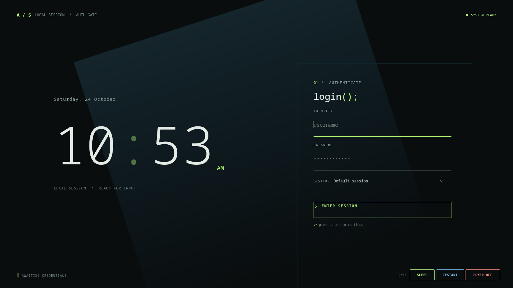

# Aurora Terminal — Minimal SDDM Login Theme for Linux

Aurora Terminal is a dark, terminal-inspired **SDDM theme for Linux**. Its
minimal login screen pairs a large 12-hour clock and clean monospace details
with a bright aurora-green accent. It is built with Qt Quick and is designed to
make the SDDM login and desktop-selection screen feel calm, clear, and at home
on a modern Linux desktop.

The theme works with desktop sessions detected by SDDM, including KDE Plasma,
GNOME, and other installed sessions. The login greeter is separate from the
desktop session you choose.

## Preview



## Features

- Minimal dark login screen with responsive layout
- Live 12-hour clock and date
- Username prefilled from SDDM's last-used account and password focus on load
- SDDM session selector for choosing an installed desktop environment
- Keyboard-friendly login: Enter moves between fields and submits credentials
- Sleep, restart, and power-off buttons that follow SDDM's available actions
- No external assets or network access required at runtime

## Requirements

- SDDM with support for the SDDM Theme API 2.0
- Qt 6 and the Qt Quick modules used by your SDDM installation

The required Qt runtime components are normally provided by your Linux
distribution's SDDM and Qt packages.

## Install

Clone the repository:

```sh
git clone https://github.com/Wasib-2005/Aurora-Terminal.git
cd Aurora-Terminal
```

Install the theme files into an SDDM theme directory:

```sh
sudo install -d /usr/share/sddm/themes/Aurora-Terminal
sudo install -m 644 Main.qml metadata.desktop /usr/share/sddm/themes/Aurora-Terminal/
```

Then select **Aurora Terminal** in your distribution's SDDM settings tool. On
KDE Plasma, open **System Settings → Colors & Themes → Login Screen (SDDM)**.
You may need administrator access to change the system-wide greeter theme.
Changing the greeter does not change the desktop session you log into.

## Uninstall

Remove the installed theme directory:

```sh
sudo rm -r /usr/share/sddm/themes/Aurora-Terminal
```

If Aurora Terminal is currently selected, choose another installed theme in
your SDDM settings before removing it.

## Project files

- `Main.qml` — login screen layout, clock, session selector, and power controls
- `metadata.desktop` — SDDM theme name, compatibility metadata, and entry point

## License

Aurora Terminal is released under the MIT License, as declared in
[`metadata.desktop`](./metadata.desktop).
