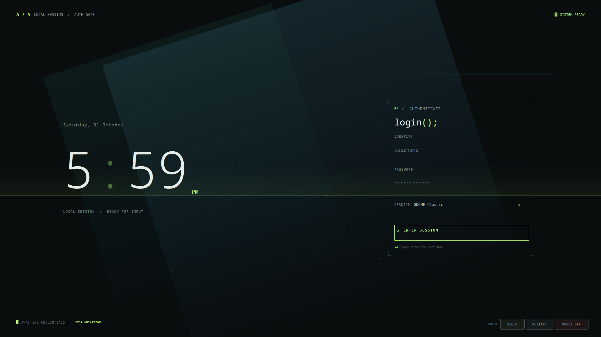

# Aurora Terminal — Animated SDDM Theme for Linux

Aurora Terminal is a dark, animated **SDDM login theme for Linux**, built with
Qt Quick and Qt 6. Its terminal-inspired login screen combines an oversized
clock, aurora motion graphics, and a clean credential form in a distinctive
green-on-charcoal design.

Use Aurora Terminal as an **SDDM theme for KDE Plasma or another Linux desktop
environment** supported by your SDDM installation. The greeter's session menu
continues to use the desktop sessions detected by SDDM.

## SDDM theme preview



## Features

- Dark terminal-style Linux login screen with a responsive Qt Quick layout
- Live 12-hour clock and date
- Animated aurora background, sweeping light streaks, scan band, and ambient details
- **STOP ANIMATION / START ANIMATION** control to pause or resume theme motion
- SDDM user prefill and desktop session selector
- Keyboard-friendly login flow with visible authentication feedback
- Sleep, restart, and power-off controls based on SDDM's available actions
- Greeter blanking after 30 seconds of inactivity; click or press a key to wake it
- No network access or external runtime assets required

## Compatibility

- SDDM Theme API 2.0
- Qt 6 with the Qt Quick modules provided by your distribution's SDDM packages
- KDE Plasma, GNOME, and other desktop sessions detected by SDDM

## Preview the theme

Run the SDDM test greeter from the theme directory to preview the login screen
without installing it:

```sh
sddm-greeter-qt6 --test-mode --theme ./
```

Press **Ctrl+C** in the terminal to close the test greeter. Test mode is for
previewing the UI; login, shutdown, restart, and suspend actions do not operate
as they would in the real SDDM greeter.

## Install

Clone the repository:

```sh
git clone https://github.com/Wasib-2005/Aurora-Terminal.git
cd Aurora-Terminal
```

Install the SDDM theme files:

```sh
sudo install -d /usr/share/sddm/themes/Aurora-Terminal
sudo install -d /usr/share/sddm/themes/Aurora-Terminal/assets
sudo install -m 644 Main.qml metadata.desktop /usr/share/sddm/themes/Aurora-Terminal/
sudo install -m 644 assets/aurora-terminal-preview.png /usr/share/sddm/themes/Aurora-Terminal/assets/
```

Then select **Aurora Terminal** in your distribution's SDDM settings tool. On
KDE Plasma, open **System Settings → Colors & Themes → Login Screen (SDDM)**.
Changing the SDDM login theme does not change the desktop session you choose
after signing in.

## Uninstall

Select another SDDM theme, then remove Aurora Terminal:

```sh
sudo rm -r /usr/share/sddm/themes/Aurora-Terminal
```

## Project files

- `Main.qml` — Qt Quick login layout, clock, motion graphics, and controls
- `metadata.desktop` — SDDM theme name, compatibility details, and entry point
- `assets/aurora-terminal-preview.png` — screenshot of the running SDDM test greeter

## License

Aurora Terminal is released under the MIT License, as declared in
[`metadata.desktop`](./metadata.desktop).
